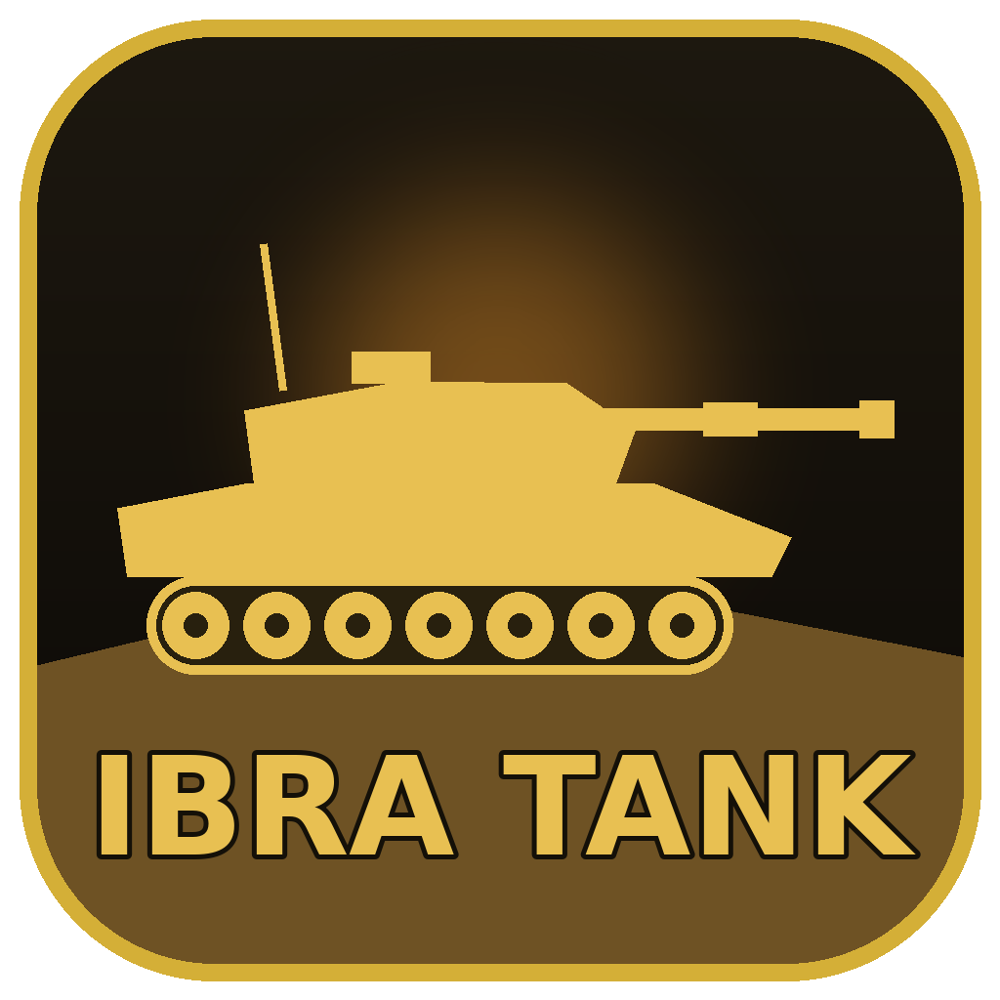

<div align="center">



# IBRA TANK — درع العراق

**لعبة دبابة ثلاثية الأبعاد (3D) بحركة جانبية ثنائية الأبعاد، بمراحل ومهام لا تنتهي.**

تصميم وتطوير **إبراهيم الخزرجي** · [تليكرام t.me/ibraprogram](https://t.me/ibraprogram) · [تيك توك @ibraprogram](https://www.tiktok.com/@ibraprogram)

</div>

---

## 🎮 فكرة اللعبة

دبابة ثلاثية الأبعاد مرسومة بالكامل بالكود (Three.js) تتحرك يمين ويسار على أرض حقيقية فيها تلال ومنحدرات. تقضي على الجنود والآليات، تجمع معدات من الحطام، وتطوّر دبابتك مع كل قتال. **الدبابة ما تموت** — إذا تضررت بالكامل تتصلح تلقائياً وتكمّل.

### 🇮🇶 مناطق العراق
أنت دبابة **الجيش العراقي** ترفع العلم العراقي وتحرّر مدن ومحافظات العراق. 15 منطقة مصمّمة يدوياً:

| # | المنطقة | المحافظة | المعالم والتفاصيل |
|---|---|---|---|
| 1 | صحراء الأنبار | الأنبار | كثبان، نخيل، طريق صحراوي |
| 2 | بغداد – الكرادة | بغداد | برج بغداد، محلات ولافتات، أسلاك المولدات |
| 3 | البصرة – شط العرب | البصرة | نهر، مشاحيف، بساتين نخيل |
| 4 | الموصل – المدينة القديمة | نينوى | منارة الحدباء، بنايات متضررة |
| 5 | ديالى – بساتين بعقوبة | ديالى | بساتين البرتقال |
| 6 | الأهوار – الجبايش | ذي قار | ماء وقصب ومضايف ومشاحيف |
| 7 | بابل الأثرية | بابل | بوابة عشتار وأسوار بابل |
| 8 | كركوك – حقول النفط | كركوك | مضخات نفط متحركة وشعلات غاز وأنابيب |
| 9 | أربيل – القلعة | أربيل | قلعة أربيل |
| 10 | جبال السليمانية – بنجوين | السليمانية | ثلوج وصنوبر |
| 11 | سامراء – الملوية | صلاح الدين | الملوية |
| 12 | بغداد – شارع الرشيد | بغداد | شناشيل، نصب الحرية، ليل وشبابيك منوّرة |
| 13 | الناصرية – زقورة أور | ذي قار | زقورة أور |
| 14 | زاخو – جسر دلال | دهوك | جسر دلال والنهر والجبال |
| 15 | بادية السماوة | المثنى | بادية وصخور |

**بعدها تتولّد مناطق جديدة بلا نهاية** من أكثر من 100 مدينة وقضاء وناحية من كل محافظات العراق (أحياء بغداد، هيت، حديثة، الفاو، القرنة، العمارة، الكوت، تلعفر، شقلاوة، العمادية…) مع أسماء مثل «سوق …»، «بساتين …»، «بادية …»، «طريق … – …»، «أهوار …».

**تفاصيل عراقية:** بيوت طابوق بشبابيك حديد، خزانات ماء وستلايتات على السطوح، سبالت، شناشيل، محلات بلافتات عراقية (كباب، صمون حجري، عطارية، مولدة الحي…)، أسلاك المولدات المتشابكة، تكسيات برتقالية، كيّات، كتل كونكريتية، سيطرة الجيش العراقي ببداية كل مرحلة، لوحات طرق خضراء بالمسافات بين المدن، وأعلام عراقية ترفرف.

الأوقات: فجر · نهار · ظهر · غروب · ليل.

### 🎬 المرحلة الخاصة — «من تمل من هاي اللعبة… تعال هنا»
زر خاص بالقائمة الرئيسية يفتح مرحلة سينمائية:
1. تقاتل بالدبابة لحد العلم العراقي، تتوقف الدبابة وينزل المقاتل.
2. يمشي للعمارة، يصعد بالمصعد الزجاجي للسطح، يطلع من باب السطح ويركب الهليكوبتر.
3. تقاتل بالهليكوبتر (رشاش يوجّه نفسه + صواريخ موجّهة) لحد مهبط الطائرات.
4. ينزل المقاتل ويصرخ، وتطلع رسالة فوق راسه: تابع صفحة المبرمج على تليجرام واكتب اقتراحاتك. **الرسالة تبقى لحد ما تضغط مطوّلاً 5 ثواني.**
5. يرجع للدبابة، بعدين للهليكوبتر مرة ثانية، لحد ما يوصل للنهر.
6. الكاميرا تقترب من المقاتل: «أدري بيك… هذا الشي إنت متخيله وتريد تكتبه بالاقتراحات».
7. يركب القارب ويقاتل الزوارق والسفن لحد الضفة الثانية.
8. ينزل ويستدير للكاميرا: «لا تنسى، كل هالشي مجاني… المهم الدعاء بظهر الغيب — إبراهيم الخزرجي برمجني وطوّرني».
9. ياخذ الدبابة ويروح، الكاميرا تصعد لفوق وتطلع كلمات شكر للي لعبوا اللعبة.

### 🎨 الرسوميات (v1.3)
- **الدبابة تتطور بـ 5 عائلات × 5 تطويرات (25 شكل)** حسب مستوى الدبابة: T-62 ← M1 Abrams ← T-90 بدروع تفاعلية ← M1A2 SEP بشفرة جرافة وراجمة ← دبابة المستقبل مع درون.
- **الجندي العراقي بـ 5 مستويات**: المتدرب، المقاتل الأساسي، العمليات المتقدم (نواظير ليلية)، القابل للتكيف (درون)، جندي المستقبل (خوذة بقناع) — جسم كامل بركب وبساطير وسترة وجيوب وأسلحة مفصّلة.
- **هليكوبتر بلاك هوك** بأجنحة صواريخ ورشاشات أبواب وكاميرا حرارية ودرونات حسب التطوير.
- **سيارات عسكرية** (رف علوي، هوائيات، برج رشاش، إسعاف) و**قوارب** (صيد، زورق مطاطي، دورية، زورق حربي، شبحي، كاتاماران، فرقاطة).
- اللافتات والكتابات صارت واقعية (مطفية ومعتّقة) مو مضيئة، وإضاءة وانعكاسات أكثر واقعية.

### 🪖 الأعداء — كل جندي مختلف
جندي بندقية · رامي رشاش · رامي آر بي جي · رامي قنابل · قنّاص · ضابط · جندي مدرّع — بأزياء مختلفة حسب البيئة (صحراوي، أخضر، رمادي مدني، أبيض ثلجي) وأغطية رأس مختلفة (خوذة، شماغ، قبعة، بيريه، قبعة قنّاص).

ومع تقدّم المراحل تظهر: **سيارات مسلّحة · شاحنات تنزّل جنود · ناقلات جند مدرعة · دبابات معادية · مروحيات.**

### 🚀 الأسلحة (تبديل بالأرقام 1–6)
| الرقم | السلاح | طريقة الحصول |
|---|---|---|
| 1 | المدفع الرئيسي 125 ملم | من البداية |
| 2 | الرشاش المحوري | من البداية |
| 3 | قذيفة كبيرة شديدة الانفجار | صندوق معدات من الحطام |
| 4 | راجمة صواريخ موجّهة | صندوق معدات من الحطام |
| 5 | قذيفة عنقودية | صندوق معدات من الحطام |
| 6 | مدفع كهرومغناطيسي (ليزر) | صندوق معدات من الحطام |

### ⬆️ التطوير
كل قتل يعطي خبرة XP. مع كل مستوى: ضرر أكبر، درع أقوى، سرعة أعلى، تلقيم أسرع — **وشكل الدبابة يتطور** (دروع جانبية ← دروع تفاعلية ← محطة رشاش آلي ← راجمة صواريخ ← درع قفصي وصفائح علوية).

صناديق الأرض والحطام: 🟨 سلاح جديد · 🟩 ذخيرة · 🟥 تصليح · 🟦 قطع تطوير.

### 📋 المهام (تتولّد تلقائياً بلا نهاية)
- **المرحلة 1:** اوصل لنهاية الخريطة
- **المرحلة 2:** شيل جندي صديق ووصّله لنقطة التسليم
- **المرحلة 3:** نقطة تبديل — توصل جندي ويستلم منك جندي ثاني
- **المرحلة 4:** تطهير المنطقة من الأعداء
- **المرحلة 5:** نقل أكثر من جندي وتوزيعهم على نقاط مختلفة
- **المرحلة 6:** اعتراض وتدمير قافلة آليات
- **المرحلة 7:** حماية موقع لمدة محددة
- **من المرحلة 8:** دمج مهمتين أو ثلاث بشكل عشوائي، والمرحلة تطول والصعوبة تزيد

## ⌨️ التحكم
| المفتاح | الوظيفة |
|---|---|
| `→` `←` أو `D` `A` | تحريك الدبابة |
| `↑` `↓` أو `W` `S` / عجلة الماوس | رفع وتنزيل المدفع |
| `Space` أو كليك | إطلاق النار |
| `1`–`6` · `Q` `E` | تبديل السلاح |
| `P` / `Esc` | إيقاف مؤقت |
| `M` · `F11` | كتم الصوت · ملء الشاشة |

التقدّم يُحفظ تلقائياً.

## 💾 التنصيب
حمّل `IBRA-TANK-Setup-x.x.x.exe` من صفحة **Releases** وشغّله. ينصّب بدون صلاحيات أدمن، ويسوي اختصار على سطح المكتب وقائمة ابدأ. التحديث: نصّب النسخة الجديدة فوق القديمة.

## 🛠️ البناء من الكود
```bash
npm install
npm start                       # تشغيل اللعبة
npm run dist                    # (على ويندوز) بناء ملف التنصيب dist/IBRA-TANK-Setup-*.exe
./scripts/build-installer.sh    # (على لينكس/ماك) بناء ملف التنصيب بدون Wine
```
أو غيّر رقم `version` في `package.json` وارفع التعديل — GitHub Actions يبني ملف التنصيب على ويندوز وينشره في Releases تلقائياً.

### هيكل المشروع
```
src/game.js       منطق اللعبة: اللاعب، الأعداء، المقذوفات، المهام، الواجهة
src/models.js     نماذج 3D: الدبابة وتطويراتها، الجنود، الآليات، المروحية، الديكور
src/world.js      بناء المرحلة: الأرض والماء والتضاريس، الشوارع، المعالم، الطقس
src/models_hd.js  النماذج الواقعية: الجنود، الدبابات، الهليكوبتر، السيارات، القوارب
src/special.js    المرحلة الخاصة السينمائية (دبابة · مصعد · هليكوبتر · قارب · الرسائل والنهاية)
src/iraq.js       مناطق العراق والمراحل المتولدة، البيوت العراقية، اللافتات، المعالم، العلم العراقي
src/fx.js         الانفجارات، الدخان، الشرار، الحطام، آثار الحرق
src/audio.js      كل الأصوات مولّدة بالكود (بدون ملفات)
src/textures.js   التمويه، الجدران، الصناديق، السماء… كلها مرسومة بالكود
main.js           نافذة Electron
installer/        سكربت NSIS لملف التنصيب
```

---
© إبراهيم الخزرجي — IBRAPROGRAM

## تحديث 1.4 — حملات المركبات

- من القائمة اختر الدبابة، الهليكوبتر، السفينة أو القوات المتكاملة. المود المتكامل ينقل الجندي بين الدبابة والهليكوبتر والسفينة داخل نفس المرحلة. لا يتغير رقم المرحلة حتى يكتمل المسار البحري، والحملة تستمر بمراحل مولدة.
- جميع المركبات تستخدم أسلحة الحملة والصحة وقطع التطوير. تمر فوق الصندوق لجمعه؛ الهليكوبتر تجذب المعدات من الأرض عند المرور فوقها.
- الهليكوبتر: A/D حركة، W/S تصويب، R/F ارتفاع وانخفاض، Space إطلاق. السفينة والدبابة: A/D حركة وW/S تصويب. الأرقام 1–6 لتبديل السلاح.
- الهليكوبتر لها تجهيزات ودروع مرئية بحسب المستوى. السفينة تتدرج بين patrol وgunboat وstealth وcatamaran وfrigate. الضرر والصحة والدرع يستمر تطويرها بعد بلوغ آخر شكل.
- حملات الجو والبحر تتنوع بين الهجوم واعتراض القوافل وحماية المواقع. القتال البحري يستبدل القوات البرية بقوارب وسفن، مع معدات تطفو على الماء.
- الحفظ الحالي متوافق مع النسخة السابقة. المودات تشترك بمستوى الحملة والترقيات؛ «لعبة جديدة» تعيد تقدم الحملة بعد تأكيد اللاعب.
- زر «اكتب رقم» يفتح عشر عمليات سرية، مع رابط طلب الرقم مجاناً على https://t.me/ibraprogram. العمليات السرية تحفظ الترقيات، ولا تغير رقم مرحلة الحملة. هذه رموز فتح محلية في مشروع مفتوح المصدر وليست نظام حماية أو دفع.

### أرقام العمليات (لصاحب اللعبة)

| الرقم | العملية | المركبة |
|---|---|---|
| 731904 | صقور الفجر | هليكوبتر |
| 582163 | حارس الميناء | سفينة |
| 946207 | درع الصحراء | دبابة |
| 315879 | عاصفة الثلج | هليكوبتر |
| 824651 | لؤلؤة الأهوار | سفينة |
| 607432 | حصار المدينة | دبابة |
| 193768 | أجنحة النخيل | هليكوبتر |
| 459281 | أسطول الليل | سفينة |
| 268594 | قلعة الجبال | دبابة |
| 870325 | عملية النصر | دبابة ثم هليكوبتر ثم سفينة داخل نفس العملية |

### التحقق

`npm test` يفحص توزيع المودات وبداية المرحلة المتكاملة وصحة الأرقام العشرة بالعربية والإنكليزية ورفض الأرقام الخاطئة. جرى أيضاً فحص تشغيل المتصفح للمودات الثلاث: الحركة والإطلاق والصحة وفتح الأسلحة وقطع التطوير وفتح العمليات السرية العشر. بناء Windows يحتاج تشغيل `npm ci` ثم `npm run dist` على جهاز يدعم Electron.


## تحديث 1.5 — تعال هنا والمود المتكامل داخل نفس المرحلة

زر **تعال هنا** الكبير يحمل عبارة «من تخلص وتستكشف كلشي تعال» ويفتح **عملية الرافدين**، مساراً طويلاً بطول 5200 وحدة و16 فصلاً، منفصلاً عن رقم مرحلة الحملة المحفوظة. كل معركة قابلة للعب، ومشاهد الركوب والنزول قصيرة ومتحركة.

1. يتبع التصوير جندياً من داخل مقر مفتوح الباب إلى الدبابة، ثم تبدأ معركة بالتصوير الجانبي.
2. إصابة براميل الوقود بقذيفة تسبب انفجاراً وتدير الكاميرا خلف الدبابة. التحكم الخلفي: W/S أو ↑/↓ تقدم ورجوع، A/D أو ←/→ يمين ويسار.
3. عند المهبط الأول ينزل الجندي ويقترب من الطائرة، ثم يتجاوزها ويكمل القتال راجلاً بمنظور الشخص الثالث إلى المهبط الثاني.
4. يصعد الهليكوبتر الثانية ويقاتل من الخلف. تدمير مستودع الوقود الثاني يعيد الكاميرا إلى الجانب.
5. في تجمع القوات الصديقة، تظهر المقاتلتان زهراء ونور وهما تصعدان دبابة الإسناد، ثم تشارك الدبابة بإطلاق النار.
6. يهبط اللاعب وينزل إلى الدبابة. تغادر دبابة الإسناد، وتصل هليكوبتر حليفة تشارك في القتال.
7. يعبر اللاعب جسراً فعلياً فوق النهر؛ تغادر الهليكوبتر وتلتحق سفينة عراقية من الأسفل وتطلق النار للمساندة.
8. يصل اللاعب إلى معسكر كبير ولافتة «إذا هالتحديث عجبكم كتبولنه تعليق بالتليكرام»، مع زر يفتح @ibraprogram وزر للعودة للقائمة.

القتال الخلفي يستخدم توجيه وتصويب الماوس نحو علامة التصويب بمنتصف الشاشة، مع مسارات قذائف وتصادمات تراعي العمق. المنظور الجانبي يحتفظ بمساعدة التصويب. Space أو الماوس للإطلاق؛ 1–6 لتبديل الأسلحة؛ R/F لتغيير ارتفاع الهليكوبتر. تتوقف المشاهد مع الإيقاف المؤقت. ترك الجولة يعيدك للحملة، ودخولها مرة أخرى يبدأ من المقر.

### تصحيح المود المتكامل

كل مرحلة من المود المتكامل تتكون من قتال بالدبابة، ونزول جندي إلى المهبط وصعود الهليكوبتر، ثم هبوط عند المرسى وخروج الجندي إلى السفينة وقتال بحري حتى النهاية. المركبات المتروكة تبقى مرئية في مواقعها. الصحة والترقيات والذخيرة مشتركة، وكل مرحلة لاحقة تعيد التسلسل داخل خريطة واحدة.

قائمة اختيار المود أصبحت قائمة داخل اللعبة بألوان داكنة وخيارات واضحة، وتعمل بالماوس والأسهم وEnter وEscape، بدلاً من ألوان القائمة الافتراضية التي تختلف حسب ويندوز.

### اختبارات الإصدار

- `npm test`: تسلسل القصة والجسر وخطة المركبات الثلاث داخل المرحلة، بالإضافة إلى اختبارات المودات والأرقام السرية.
- `npm run test:story`: فحص المتصفح للفصول الستة عشر، إصابات براميل الوقود، التحكم الخلفي، إطلاق سلاح الجندي، الحلفاء، الجسر والنهاية وإعادة الدخول.
- `npm run test:combined`: فحص الانتقال من دبابة إلى هليكوبتر إلى سفينة داخل نفس رقم المرحلة، الإيقاف المؤقت أثناء الركوب، جمع الصحة بعد الانتقالات، والانتقال للمرحلة التالية.

اختبارات المتصفح تحتاج Playwright ومتصفح Chromium مثبتين. يمكن ضبط `PLAYWRIGHT_MODULE` لمسار حزمة موجودة و`PLAYWRIGHT_CHANNEL=msedge` لاستعمال Edge. اختبارات التسلسل تستخدم مواضع وعدّادات قتال مجهزة لاختبار بوابات المشاهد بسرعة؛ براميل الوقود تُفحص بقذائف حقيقية عبر حلقة القتال، وليست تجربة يدوية كاملة بطول الجولة. لم يُبنَ مثبت Windows محلياً.


## تحديث 1.6 — قتال مستمر وتحكم الماوس

- موجات جنود وآليات تستمر في كل المقاطع القابلة للعب في «تعال هنا»، حتى بعد استيفاء عدد قتلى المهمة. حد الأعداء المتزامنين وتلاشي البعيدين يحافظان على الأداء.
- بالمنظور الخلفي للجندي والدبابة والهليكوبتر: حرّك الماوس لتوجيه الكاميرا والتصويب، وWASD للحركة بالنسبة لاتجاه الكاميرا، وكليك أيسر للإطلاق. أول كليك على ساحة اللعب يثبت الماوس، وEsc يحرره ويوقف اللعب. يوجد بديل لتحريك الماوس دون تثبيت عند عدم توفره.
- علامة تصويب وسط الشاشة تحدد مسار الرمية. لا يختار المنظور الخلفي عدواً تلقائياً؛ القذيفة تتجه إلى ما تشير إليه العلامة، مع تعويض سقوط القذيفة حسب السلاح. يمكن الدوران والتصويب في جميع الاتجاهات.
- تسارع وتوقف تدريجيان، ومنع زيادة سرعة الحركة القطرية، وحركة أرجل مرتبطة بمسافة المشي الفعلية، بما فيها الحركة الجانبية. الجندي يبدأ القتال الراجل بالرشاش.
- تصوير الطائرة يشمل الأرض والطائرة والميدان الأمامي، ويتكيف مع ارتفاعها في الجولة القصصية والحملات والمود المتكامل. علامات الأعداء تساعد على رؤية الجنود على الأرض. امتدت أرضية العالم والماء إلى المقدمة لتجنب انكشاف حافة الخريطة مع الكاميرا الأوسع.
- اختبارات المتصفح تفحص تحريك الماوس والإطلاق بالكليك للمركبات الثلاث واستمرار الموجات بعد بلوغ هدف القتال، إضافة إلى فحص تسلسل الفصول السابق.

`npm run test:flight` يفحص بقاء مواقع أعداء الأرض أمام الطائرة داخل الشاشة عند ارتفاعي 5 و22 وحدة.


## تحديث 1.6.1 — العودة للتصوير الجانبي

أُلغي منظور الشخص الثالث بالكامل من جميع مقاطع القتال في «تعال هنا»، وأُزيل تدوير الكاميرا بالماوس وتثبيت المؤشر وعلامة التصويب المركزية. القتال كله جانبي للجندي والدبابة والهليكوبتر، بما فيه المقاطع بعد انفجار الوقود. التحكم: A/D أو الأسهم للحركة يميناً ويساراً، W/S أو أعلى/أسفل للتصويب، والكليك الأيسر أو Space للإطلاق. R/F لارتفاع الهليكوبتر. لا تتحول الكاميرا إلى الخلف.

مشاهد الخروج والركوب والنزول القصصية، تبديل المركبات، الأعداء والموجات المستمرة، الحلفاء والجسر، وتصوير الهليكوبتر الواسع باقية. هذه التعليمات تحل محل تعليمات المنظور الخلفي والماوس في سجل الإصدارات أعلاه. الاختبار يتحقق من أن كل فصول القتال جانبية ولا توجد واجهة لتدوير الكاميرا أو تثبيت الماوس.


## تحديث 1.7 — هدية الإصدار والإسناد الجماعي

- زر «هدية الإصدار» أصغر وتحت «طريقة اللعب والتحكم»، وأزرار القائمة زجاجية شفافة مع الحفاظ على وضوح النص.
- إصلاح التصويب المساعد للهليكوبتر: اختيار الهدف والإطلاق يتبعان اتجاهها يميناً ويساراً، في الجولة والحملات والمود المتكامل.
- ونش مشترك في كل المودات: عند الاقتراب من الصحة أو السلاح أو الذخيرة أو قطع التطوير، تتوقف الهليكوبتر للتحويم، ينزل الحبل والخطاف، ويرتفع الصندوق فعلياً قبل احتساب فائدته. ينزل الحبل أيضاً إلى الجندي الصديق الذي يلوّح، ويرفعه قبل جلوسه في الطائرة. التوقف المؤقت يوقف الونش، ومغادرة المرحلة تلغيه بأمان.
- حملات الهليكوبتر تتضمن مهام نقل جنود، وتوجد فرص إنقاذ إضافية بالمود المتكامل والجولة.
- المهابط ومواقف المركبات والخروج من المعسكر أصبحت بجانب الطريق، وتبتعد الحطامات القريبة عن موضع النزول. انتقالات المود المتكامل تعرض إنهاء المسار البري أو الجوي، الوقوف أو الهبوط جانباً، نزول الجندي ومشيه إلى المركبة التالية، ثم إقلاع أو انطلاق المركبة.
- الطائرة الأولى في الجولة تتلقى ضربة RPG من جندي معادٍ بلقطة تتبع المقذوف؛ تحترق قبل صعود اللاعب، فيهرب منها ويكمل القتال راجلاً. سبب هذا الانتقال هو تدمير الطائرة، وبقية الانتقالات عند انتهاء مهمة المركبة أو خط سيرها.
- الجولة الآن 18 فصلاً. بين القتال الراجل والهليكوبتر توجد سيارة عسكرية قابلة للقيادة، يصعد معك جندي يشارك بالإطلاق، ودراجتان مسلحتان توفران إسناداً حقيقياً. بعد انتهاء مسار السيارة تتركها للقوات الأرضية وتصعد الهليكوبتر، وتستمر السيارة والدراجات والحلفاء في المساندة.
- كل القتال يبقى جانبياً؛ لم يُعد منظور الشخص الثالث.

`npm run test:air-support` يفحص اتجاه الإطلاق إلى الخلف، وأن الأنواع الأربعة من الصناديق تُرفع بالحبل قبل جمعها، ورفع الجندي في حملة الهليكوبتر والمود المتكامل والجولة القصصية. اختبارات الجولة تشمل تدمير الطائرة الأولى وركوب السيارة وإطلاق الراكب والدراجات، واختبار المود المتكامل يغطي الانتقالات الجانبية الأطول.
